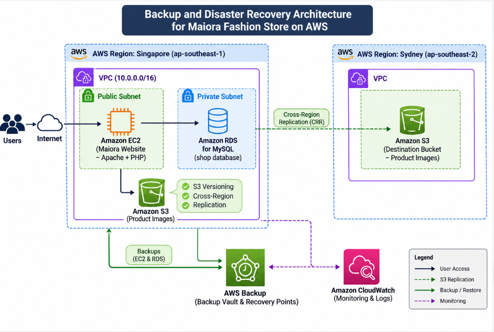

# AWS MULTI-REGION BACKUP & DISASTER RECOVERY SYSTEM

## A Solution for Data Backup, Cross-Region Recovery, and Incident Monitoring

## 1. Executive Summary

This project focuses on researching and developing a Multi-Region Backup and Disaster Recovery (BDR) system on Amazon Web Services (AWS) to improve data protection and support application recovery when failures occur in the primary deployment environment.

The system is developed based on Maiora, a fashion e-commerce website built using PHP. Amazon EC2 is used to host the web application, Amazon RDS manages the MySQL database, and Amazon S3 stores product images.

The proposed architecture uses two AWS Regions: Singapore (ap-southeast-1) as the primary region and Sydney (ap-southeast-2) as the disaster recovery region.

The solution integrates several AWS services to achieve three main objectives: protecting resources through AWS Backup and Amazon S3 Versioning; replicating data across regions using S3 Cross-Region Replication; and monitoring application availability through Amazon Route 53, Amazon CloudWatch, and Amazon SNS.

Instead of focusing on Recovery Time Objective (RTO) and Recovery Point Objective (RPO), this project evaluates backup capabilities, resource restoration, data integrity, cross-region replication, website availability in the recovery environment, and incident monitoring and notification effectiveness.

The expected outcome is a practical Multi-Region BDR model that can be deployed and tested, together with a technical workshop document that can serve as a reference for small and medium-sized businesses.

## 2. Problem Statement

### 2.1. Current Problems

Web applications deployed in a single AWS Region may face significant risks when the primary region experiences service disruptions or infrastructure failures. Such incidents can affect application servers, databases, and stored data, resulting in website downtime and interruptions to business operations.

Furthermore, relying only on isolated backup mechanisms without a recovery environment in another region can make system restoration difficult. Data may become unavailable, incomplete, or inconsistent if backup and recovery procedures have not been properly tested.

For e-commerce websites, protecting customer information, product details, order records, and product images is essential for maintaining business continuity.

### 2.2. Proposed Solution

This project proposes a Multi-Region BDR system on AWS to address these challenges through the following approaches:

- Use AWS Backup to manage and create backups of critical AWS resources, including EC2 instances and RDS databases.
- Enable Amazon S3 Versioning to preserve multiple versions of objects and support recovery from accidental deletion or overwriting.
- Implement S3 Cross-Region Replication (CRR) to replicate product images from Singapore to Sydney.
- Prepare a disaster recovery environment in Sydney to support application server and database restoration from backups.
- Use Amazon Route 53 Health Check to monitor website availability.
- Integrate Amazon CloudWatch and Amazon SNS to monitor service status and send email notifications when incidents are detected.

### 2.3. Benefits

- Reduce the risk of data loss when failures occur in the primary region.
- Support the recovery of application servers, databases, and product images from backups.
- Improve data protection through versioning and cross-region replication.
- Provide a recovery environment for testing website availability.
- Detect and report incidents through monitoring and notification services.
- Establish reusable procedures for deployment, backup, restoration, and testing.

## 3. Proposed Architecture

The proposed architecture follows a two-region deployment model. Singapore serves as the primary region, where the Maiora website operates and connects to its database. Sydney serves as the disaster recovery region, maintaining replicated data and supporting system restoration when required.

The system does not implement automatic failover for all services between the two regions. Recovery in Sydney is performed through a controlled process using available backups and replicated data.

### 3.1. AWS Services Used

- **Amazon VPC:** Provides the `backup-dr-vpc` network infrastructure, including public and private subnets for application and database resources.
- **Amazon EC2:** Hosts the `app-server` instance running the Maiora website using PHP and Apache. An Elastic IP is used to maintain the primary server's public IPv4 address.
- **Amazon RDS:** Hosts the `backup-dr-db` MySQL database, which stores user accounts, product information, shopping cart data, and orders. Public access is disabled.
- **Amazon S3:** Stores website product images. Versioning is enabled to maintain object versions, while Cross-Region Replication copies data to a bucket in Sydney.
- **AWS Backup:** Centralizes backup management through Backup Vaults and Backup Plans, supporting backup and restoration of configured resources.
- **Amazon Route 53:** Uses Health Check to monitor the availability of the primary website.
- **Amazon CloudWatch:** Monitors Health Check status and resource metrics, and generates alarms when abnormal conditions are detected.
- **Amazon SNS:** Sends email notifications to administrators when CloudWatch Alarms enter the ALARM state.
- **AWS IAM:** Manages access permissions through users, groups, and service roles to ensure that backup and recovery operations are properly authorized.

### 3.2. Component Design

- **Web Application:** The Maiora website is deployed on an EC2 instance in Singapore. Users access the website through its public IP address or configured domain name.
- **Database:** The EC2 instance connects to the RDS MySQL database through the internal network, with Security Groups restricting access.
- **Data Protection:** AWS Backup creates backups of selected resources. Amazon S3 Versioning supports the restoration of previous object versions when necessary.
- **Cross-Region Replication:** S3 CRR replicates objects from the Singapore bucket to the Sydney bucket.
- **System Recovery:** When an incident occurs, administrators use AWS Backup Recovery Points to restore resources in the recovery environment.
- **Monitoring:** Route 53 Health Check monitors website availability, while CloudWatch receives and evaluates monitoring metrics.
- **Notifications:** SNS sends email notifications to administrators when CloudWatch detects an incident.

## 4. Technical Implementation

### 4.1. Implementation Phases

The project is divided into several implementation phases. Each phase produces verifiable results through the AWS Management Console, website interface, or relevant command-line checks.

**Phase 1: Infrastructure and Access Management**

- Explore the AWS environment and required services.
- Create and configure IAM users, groups, and access permissions.
- Configure service roles for AWS Backup.
- Build the VPC, subnets, Internet Gateway, Route Tables, and Security Groups.

**Phase 2: Application and Database Deployment in Singapore**

- Create an EC2 instance for the application server.
- Install Apache, PHP, and required software components.
- Deploy the Maiora e-commerce website.
- Create a MySQL database using Amazon RDS.
- Configure private connectivity between EC2 and RDS.
- Test registration, login, product management, shopping cart, and checkout functions.

**Phase 3: S3 Storage and Data Protection**

- Create an S3 bucket for product images.
- Enable Versioning and data encryption.
- Configure Cross-Region Replication between Singapore and Sydney.
- Verify object replication between the two buckets.
- Test object version recovery after accidental deletion or overwriting.

**Phase 4: Disaster Recovery Environment in Sydney**

- Prepare the AWS environment in Sydney.
- Deploy or restore the application server from an existing backup.
- Restore the database from an appropriate backup.
- Verify application-to-database connectivity after restoration.
- Test access to product images from the recovery bucket.
- Compare data between the primary and recovery environments.

**Phase 5: Backup Implementation Using AWS Backup**

- Create the `BackupDR-Vault` Backup Vault.
- Configure a Backup Plan for selected resources.
- Assign EC2 and RDS resources to the backup policy.
- Execute and monitor Backup Jobs.
- Verify Recovery Points after successful backups.
- Perform restoration tests to validate backup usability.

**Phase 6: Monitoring and Notification Implementation**

- Create a Route 53 Health Check to monitor website availability.
- Configure a CloudWatch Alarm to monitor Health Check status.
- Set up appropriate monitoring alarms for EC2 and RDS.
- Create the `BackupDR-Alerts-Route53` SNS Topic.
- Subscribe an email address to receive notifications.
- Verify email alerts when incidents occur.

**Phase 7: System Testing and Evaluation**

- Test EC2 and RDS backup capabilities using AWS Backup.
- Restore the application server from a Recovery Point.
- Restore the database and compare data after recovery.
- Test the restoration of previous S3 object versions.
- Verify replicated data in Sydney.
- Simulate an application server failure.
- Verify website availability in the recovery environment.
- Test incident detection and email notifications.
- Document test results, screenshots, and identified issues.

### 4.2. Technical Requirements

- An AWS account with sufficient permissions to create, configure, and manage the required services.
- Two AWS Regions: Singapore (ap-southeast-1) and Sydney (ap-southeast-2).
- AWS Management Console as the primary deployment interface, with AWS CLI used when necessary.
- Basic knowledge of networking, Linux, EC2, RDS, S3, IAM, and AWS monitoring services.
- Ability to deploy and test a PHP web application connected to a MySQL database.

## 5. Project Timeline and Milestones

The project is organized into individual phases, combining theoretical research with practical implementation on AWS.

- **Phase 1:** Complete AWS fundamentals, IAM configuration, and VPC infrastructure.
- **Phase 2:** Complete EC2, RDS, and Maiora website deployment in Singapore.
- **Phase 3:** Complete S3 configuration, Versioning, and Cross-Region Replication.
- **Phase 4:** Prepare the Sydney recovery environment and test resource restoration.
- **Phase 5:** Complete AWS Backup, Backup Vault, Backup Plan, and Recovery Point verification.
- **Phase 6:** Implement Route 53 Health Check, CloudWatch Alarm, and SNS email notifications.
- **Phase 7:** Perform system testing, evaluate results, and finalize technical documentation.

Implementation results are documented through AWS Console screenshots, resource status information, website testing results, and restored data verification.

## 6. Budget Estimation

The total implementation cost depends on resource types, usage duration, storage capacity, and the amount of data transferred between AWS Regions.

To align with the project's research and practical objectives, the implementation prioritizes appropriately sized resources and only maintains services required for deployment and testing. The disaster recovery environment does not need to remain fully operational at all times.

### 6.1. Cost Factors

- **Amazon EC2:** Costs depend on instance running hours, EBS storage capacity, and related networking resources.
- **Amazon RDS:** Costs depend on DB instance running hours, storage capacity, and applicable backup storage charges.
- **Amazon S3:** Costs include data storage, PUT, GET, COPY requests, Versioning, and Replication operations.
- **Cross-Region Data Transfer:** Charges may apply when replicating data between Singapore and Sydney.
- **AWS Backup:** Costs depend on Recovery Point storage and other service operations according to AWS pricing.
- **Amazon Route 53:** Costs are associated with Health Check usage.
- **Amazon CloudWatch:** Costs depend on the number of alarms, metrics, and monitoring operations.
- **Amazon SNS:** Notification costs depend on notification types and the number of messages delivered.

### 6.2. Cost Control Measures

- Use appropriately sized EC2 instances for the test application.
- Launch the disaster recovery environment only when testing or demonstration is required.
- Stop or terminate unused EC2 instances after testing.
- Avoid continuously running RDS instances in both regions when unnecessary.
- Configure backup retention periods according to project requirements.
- Use S3 Lifecycle policies to transition eligible data to lower-cost storage classes.
- Remove unused testing resources and review remaining snapshots, Recovery Points, and Elastic IP addresses.
- Monitor AWS spending through AWS Billing and Cost Explorer.
- Configure AWS Budgets to receive notifications when spending exceeds the expected threshold.

## 7. Risk Assessment

### 7.1. Risk Matrix

- **Unexpected Cost Increases:** May occur when EC2, RDS, or storage resources remain active for extended periods. Impact: Medium; Likelihood: Medium.
- **Incomplete Data Replication:** May occur when S3 Replication encounters errors or has not completed. Impact: High; Likelihood: Medium.
- **Unsuccessful Resource Restoration:** May result from incorrect IAM configurations, AWS Backup permissions, or restoration parameters. Impact: High; Likelihood: Medium.
- **Incomplete Restored Data:** May occur when backups do not contain the required data or restoration has not completed successfully. Impact: High; Likelihood: Medium.
- **Monitoring and Notification Failure:** May occur due to incorrect Health Check, CloudWatch Alarm, or SNS configuration. Impact: Medium; Likelihood: Low.
- **Website Unavailability in the Recovery Region:** May result from incorrect server settings, database configuration, IP addresses, or network connectivity. Impact: High; Likelihood: Medium.

### 7.2. Risk Mitigation Strategies

- **Cost Control:** Monitor AWS Billing, configure AWS Budgets, and stop unnecessary resources.
- **Data Protection:** Verify S3 Replication and Versioning status and compare data between regions.
- **Backup Validation:** Monitor Backup Jobs, verify Recovery Points, and check backup status.
- **Recovery Validation:** Review IAM Roles, IAM permissions, and resource configurations before restoration.
- **Application Validation:** Verify database connectivity, website configuration, and product image availability after restoration.
- **Notification Validation:** Check Health Check status, CloudWatch Alarms, and email delivery.

### 7.3. Contingency Plan

- If AWS Backup restoration fails, use another suitable backup to recover the required resources.
- If S3 replication is incomplete, investigate the replication status and use available object versions.
- If the website is unavailable in Sydney, inspect EC2, application configuration, database connectivity, and network settings.
- If a live demonstration fails, use screenshots and recorded videos showing the implementation and testing procedures.

## 8. Expected Outcomes

### 8.1. Technical Outcomes

Upon completion, the project is expected to achieve the following results:

- Deploy the Maiora e-commerce website on Amazon EC2 with Amazon RDS as its database management system.
- Establish a centralized backup system using AWS Backup and manage Recovery Points through a Backup Vault.
- Implement S3 Versioning to support data recovery after accidental deletion or overwriting.
- Configure S3 Cross-Region Replication to maintain copies of product images in Sydney.
- Restore required resources from backups and verify website functionality in the recovery environment.
- Validate data integrity by comparing product information, user accounts, orders, and images before and after restoration.
- Establish website monitoring and email notifications for detected incidents.
- Develop practical backup, recovery, testing, and incident-handling procedures for the BDR system.

### 8.2. System Evaluation Criteria

Instead of using RTO and RPO, this project evaluates system performance based on the following practical criteria:

- **Backup Capability:** EC2 and RDS resources are backed up successfully, with valid Recovery Points available.
- **Recovery Capability:** Resources can be restored from Recovery Points and returned to a verifiable operating state.
- **Data Integrity:** Restored data is compared with the original data, including product information, user accounts, and orders.
- **Cross-Region Replication:** Configured objects are successfully replicated to the S3 bucket in Sydney.
- **Application Availability:** The website can be deployed or restored in the recovery environment, and its main functions can be tested.
- **Monitoring and Notification Effectiveness:** The system detects website unavailability and sends email notifications to administrators.

### 8.3. Practical Value

This project goes beyond studying individual AWS services by integrating them into a practical Backup and Disaster Recovery system that can be deployed, tested, and evaluated.

The proposed model can serve as a technical reference for small and medium-sized businesses seeking solutions to protect data, restore applications, and reduce the impact of cloud infrastructure failures.

Furthermore, the project provides practical implementation procedures for AWS Backup, Amazon S3, Amazon EC2, Amazon RDS, and AWS monitoring services.