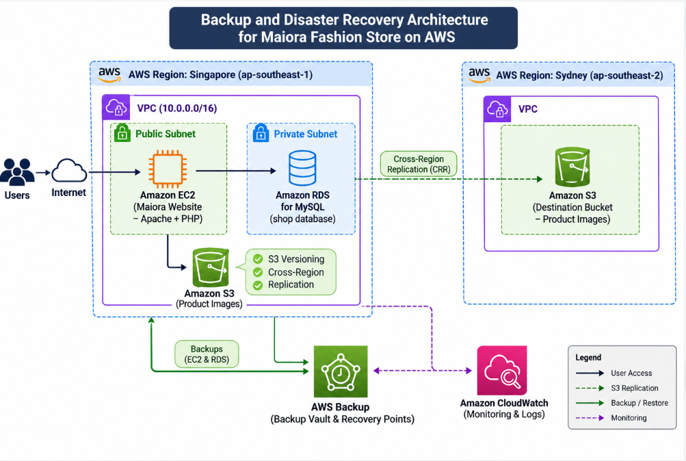

---
title: "Bản đề xuất"
date: 2026-11-12
weight: 2
chapter: false
pre: " <b> 2. </b> "
---

# THIẾT KẾ VÀ TRIỂN KHAI HỆ THỐNG BACKUP VÀ DISASTER RECOVERY TRÊN AMAZON WEB SERVICES (AWS)

## 1. Tóm tắt đề tài

Đề tài tập trung thiết kế và triển khai hệ thống sao lưu dữ liệu (Backup) và khôi phục sau thảm họa (Disaster Recovery - DR) trên nền tảng Amazon Web Services (AWS), áp dụng cho website thương mại điện tử Maiora Fashion Store.

Hệ thống sử dụng các dịch vụ AWS như Amazon EC2, Amazon RDS, Amazon S3 và AWS Backup để bảo vệ máy chủ ứng dụng, cơ sở dữ liệu và dữ liệu hình ảnh sản phẩm. Bên cạnh đó, Amazon S3 Cross-Region Replication được sử dụng để sao chép dữ liệu hình ảnh từ Region Singapore sang Region Sydney nhằm tăng khả năng bảo vệ dữ liệu khi xảy ra sự cố tại Region chính.

Thông qua việc triển khai và kiểm thử các tình huống khôi phục, đề tài đánh giá khả năng phục hồi của hệ thống và đề xuất hướng cải thiện để nâng cao tính sẵn sàng, độ an toàn và khả năng duy trì hoạt động của website.

## 2. Tuyên bố vấn đề

Trong môi trường thương mại điện tử, dữ liệu sản phẩm, thông tin khách hàng, đơn hàng và hình ảnh sản phẩm đóng vai trò quan trọng đối với hoạt động kinh doanh. Việc mất dữ liệu hoặc gián đoạn máy chủ có thể khiến website không thể hoạt động bình thường, ảnh hưởng đến trải nghiệm người dùng và hoạt động quản lý đơn hàng.

Các sự cố có thể xảy ra bao gồm:

- Máy chủ EC2 gặp lỗi hoặc bị xóa ngoài ý muốn.
- Cơ sở dữ liệu Amazon RDS bị mất dữ liệu hoặc không thể truy cập.
- Hình ảnh sản phẩm trên Amazon S3 bị xóa hoặc ghi đè.
- Sự cố tại Region chính làm gián đoạn khả năng truy cập tài nguyên.
- Cấu hình ứng dụng hoặc cơ sở dữ liệu bị thay đổi sai.

Nếu không có cơ chế sao lưu và khôi phục phù hợp, việc phục hồi hệ thống có thể mất nhiều thời gian và dữ liệu quan trọng có nguy cơ bị mất.

Vì vậy, việc triển khai hệ thống Backup và Disaster Recovery trên AWS là cần thiết nhằm bảo vệ dữ liệu, hỗ trợ khôi phục tài nguyên và giảm thiểu ảnh hưởng khi xảy ra sự cố.

## 3. Kiến trúc giải pháp

### 3.1. Mô hình kiến trúc

Hệ thống được triển khai trên hai AWS Region:

- Region chính: Asia Pacific (Singapore) - `ap-southeast-1`.
- Region dự phòng: Asia Pacific (Sydney) - `ap-southeast-2`.

Tại Region Singapore, hệ thống triển khai website Maiora Fashion Store trên Amazon EC2, sử dụng Amazon RDS MySQL để lưu trữ dữ liệu và Amazon S3 để lưu trữ hình ảnh sản phẩm.

AWS Backup được sử dụng để tạo và quản lý các điểm khôi phục cho tài nguyên EC2 và RDS. Đối với dữ liệu hình ảnh, Amazon S3 Versioning kết hợp với Cross-Region Replication hỗ trợ lưu giữ các phiên bản đối tượng và sao chép dữ liệu sang Region Sydney.

### 3.2. Các thành phần chính

- Amazon VPC: Xây dựng môi trường mạng riêng cho hệ thống, bao gồm các Public Subnet và Private Subnet.
- Amazon EC2: Triển khai máy chủ ứng dụng chạy Amazon Linux, Apache và PHP.
- Amazon RDS for MySQL: Lưu trữ cơ sở dữ liệu `shop`, bao gồm thông tin người dùng, sản phẩm, giỏ hàng và đơn hàng.
- Amazon S3: Lưu trữ hình ảnh sản phẩm của website.
- Amazon S3 Versioning: Lưu giữ các phiên bản khác nhau của đối tượng để hỗ trợ khôi phục khi dữ liệu bị ghi đè hoặc xóa.
- Amazon S3 Cross-Region Replication: Sao chép dữ liệu hình ảnh từ bucket tại Singapore sang bucket tại Sydney theo cấu hình replication.
- AWS Backup: Quản lý kế hoạch sao lưu, Backup Vault và Recovery Point cho các tài nguyên được hỗ trợ.
- Amazon CloudWatch: Hỗ trợ theo dõi trạng thái và hoạt động của tài nguyên AWS khi được cấu hình.

### 3.3. Nguyên lý hoạt động

Website được người dùng truy cập thông qua máy chủ ứng dụng Amazon EC2. EC2 kết nối đến Amazon RDS MySQL để truy vấn và cập nhật dữ liệu. Hình ảnh sản phẩm được lưu trữ trên Amazon S3 và được website sử dụng thông qua đường dẫn đối tượng.

AWS Backup thực hiện sao lưu các tài nguyên được lựa chọn và tạo Recovery Point để phục vụ quá trình khôi phục. Khi xảy ra sự cố, quản trị viên có thể sử dụng Recovery Point phù hợp để khôi phục tài nguyên EC2 hoặc RDS.

Đối với dữ liệu hình ảnh, S3 Versioning cho phép truy xuất các phiên bản trước đó. Cross-Region Replication hỗ trợ sao chép các đối tượng đáp ứng điều kiện cấu hình sang bucket tại Sydney.

Việc khôi phục và chuyển đổi hoạt động giữa các tài nguyên được thực hiện theo quy trình quản trị thủ công trong phạm vi mô hình triển khai.

### 3.4. Sơ đồ kiến trúc

## 4. Phạm vi triển khai kỹ thuật

Đề tài tập trung vào các nội dung triển khai sau:

### 4.1. Thiết kế và cấu hình hạ tầng mạng

- Tạo Amazon VPC với dải địa chỉ IP `10.0.0.0/16`.
- Phân chia Public Subnet và Private Subnet.
- Cấu hình Internet Gateway và Route Table.
- Thiết lập Security Group để kiểm soát lưu lượng truy cập.
- Triển khai EC2 trong Public Subnet và cấu hình kết nối đến RDS trong Private Subnet.

### 4.2. Triển khai máy chủ ứng dụng

- Khởi tạo EC2 sử dụng Amazon Linux.
- Cài đặt và cấu hình Apache, PHP.
- Triển khai website thương mại điện tử Maiora Fashion Store.
- Kiểm tra khả năng truy cập website và hoạt động của các chức năng chính.

### 4.3. Cấu hình cơ sở dữ liệu và lưu trữ

- Tạo Amazon RDS for MySQL.
- Khởi tạo cơ sở dữ liệu `shop`.
- Cấu hình kết nối từ EC2 đến RDS thông qua Security Group.
- Tạo Amazon S3 Bucket để lưu trữ hình ảnh sản phẩm.
- Cấu hình S3 Versioning để bảo vệ các phiên bản dữ liệu.
- Thiết lập Cross-Region Replication từ Singapore sang Sydney.

### 4.4. Triển khai hệ thống Backup

- Tạo AWS Backup Vault.
- Cấu hình Backup Plan và Backup Rule.
- Lựa chọn tài nguyên EC2 và RDS cần sao lưu.
- Thực hiện Backup Job.
- Kiểm tra trạng thái và Recovery Point được tạo ra.

### 4.5. Triển khai và kiểm thử Disaster Recovery

- Khôi phục máy chủ EC2 từ Recovery Point.
- Khôi phục cơ sở dữ liệu RDS từ bản sao lưu.
- Kiểm tra cấu hình kết nối giữa ứng dụng và cơ sở dữ liệu sau khi khôi phục.
- Kiểm tra khả năng truy cập website.
- Kiểm tra khả năng khôi phục hình ảnh sản phẩm bằng S3 Versioning.
- Kiểm tra dữ liệu được sao chép tại Region Sydney.

### 4.6. Kiểm thử và đánh giá hệ thống

- Kiểm tra hoạt động của website sau khi triển khai.
- Mô phỏng tình huống máy chủ ứng dụng gặp sự cố.
- Mô phỏng tình huống dữ liệu bị xóa hoặc thay đổi ngoài ý muốn.
- Thực hiện quy trình khôi phục tài nguyên từ Recovery Point.
- Đánh giá kết quả khôi phục và các hạn chế của mô hình.

## 5. Lộ trình và các mốc triển khai

| Giai đoạn | Nội dung thực hiện | Kết quả |
|---|---|---|
| Giai đoạn 1 | Tìm hiểu AWS và các dịch vụ Backup, DR | Xác định công nghệ sử dụng |
| Giai đoạn 2 | Thiết kế kiến trúc và cấu hình VPC | Hoàn thiện hạ tầng mạng |
| Giai đoạn 3 | Triển khai EC2 và website | Website hoạt động |
| Giai đoạn 4 | Cấu hình RDS và S3 | Hoàn thiện lưu trữ dữ liệu |
| Giai đoạn 5 | Cấu hình AWS Backup và S3 Replication | Tạo cơ chế bảo vệ dữ liệu |
| Giai đoạn 6 | Thực hiện khôi phục và kiểm thử | Đánh giá khả năng phục hồi |
| Giai đoạn 7 | Tổng hợp kết quả và hoàn thiện báo cáo | Hoàn thành đề tài |

## 6. Ước tính ngân sách

Các dịch vụ AWS được sử dụng trong đề tài có thể phát sinh chi phí tùy theo thời gian hoạt động, dung lượng lưu trữ, số lượng bản sao lưu và lượng dữ liệu truyền tải.

Các thành phần có khả năng phát sinh chi phí bao gồm:

- Amazon EC2: Chi phí sử dụng máy chủ và dung lượng EBS.
- Amazon RDS: Chi phí phiên bản DB Instance, dung lượng lưu trữ và bản sao lưu.
- Amazon S3: Chi phí lưu trữ đối tượng, Versioning và các yêu cầu truy cập.
- AWS Backup: Chi phí lưu trữ bản sao lưu và các hoạt động liên quan.
- Cross-Region Replication: Chi phí yêu cầu sao chép và truyền dữ liệu giữa các Region.
- Các dịch vụ mạng: Có thể phát sinh chi phí truyền dữ liệu và tài nguyên mạng.

Để kiểm soát ngân sách, hệ thống được triển khai trong phạm vi thử nghiệm. Các tài nguyên không cần thiết sẽ được dừng hoặc xóa sau khi hoàn thành kiểm thử. Các bản sao lưu và dữ liệu cần thiết cho quá trình đánh giá sẽ được giữ lại theo kế hoạch.

## 7. Đánh giá rủi ro và phương án xử lý

| Rủi ro | Ảnh hưởng | Phương án xử lý |
|---|---|---|
| EC2 bị lỗi hoặc bị xóa | Website ngừng hoạt động | Khôi phục EC2 từ AWS Backup |
| RDS không thể truy cập | Website không thể truy vấn dữ liệu | Khôi phục RDS từ Recovery Point và cập nhật Endpoint nếu cần |
| Hình ảnh sản phẩm bị xóa | Website thiếu hình ảnh | Sử dụng S3 Versioning hoặc dữ liệu đã được replication |
| Dữ liệu bị ghi đè | Nội dung không còn đúng | Truy xuất phiên bản đối tượng trước đó |
| Region chính gặp sự cố | Tài nguyên tại Region chính không thể truy cập | Sử dụng dữ liệu đã được sao chép tại Region Sydney và thực hiện quy trình khôi phục phù hợp |
| Cấu hình IAM không chính xác | Backup hoặc Restore thất bại | Kiểm tra IAM Role, Trust Relationship và quyền cần thiết |

Mô hình hiện tại không triển khai cơ chế tự động chuyển đổi toàn bộ hệ thống sang Region Sydney. Việc khôi phục EC2, RDS và điều chỉnh cấu hình ứng dụng được thực hiện thủ công. Đây là giới hạn cần được xem xét khi đánh giá giải pháp.

## 8. Kết quả dự kiến

Sau khi hoàn thành đề tài, hệ thống dự kiến đạt được các kết quả sau:

- Xây dựng được hạ tầng AWS phục vụ website Maiora Fashion Store.
- Triển khai thành công website sử dụng EC2, RDS MySQL và S3.
- Thiết lập được cơ chế sao lưu tài nguyên EC2 và RDS bằng AWS Backup.
- Tạo và quản lý được Recovery Point phục vụ khôi phục dữ liệu.
- Cấu hình S3 Versioning và Cross-Region Replication để tăng khả năng bảo vệ hình ảnh sản phẩm.
- Thực hiện được quy trình khôi phục máy chủ và cơ sở dữ liệu từ bản sao lưu.
- Kiểm thử được một số tình huống mất dữ liệu và gián đoạn dịch vụ.
- Đánh giá được ưu điểm, hạn chế và hướng phát triển của mô hình Backup và Disaster Recovery trên AWS.

Thông qua đề tài, người thực hiện có cơ hội vận dụng kiến thức về điện toán đám mây, quản trị hạ tầng, lưu trữ dữ liệu, sao lưu và khôi phục hệ thống vào một mô hình ứng dụng thực tế.
