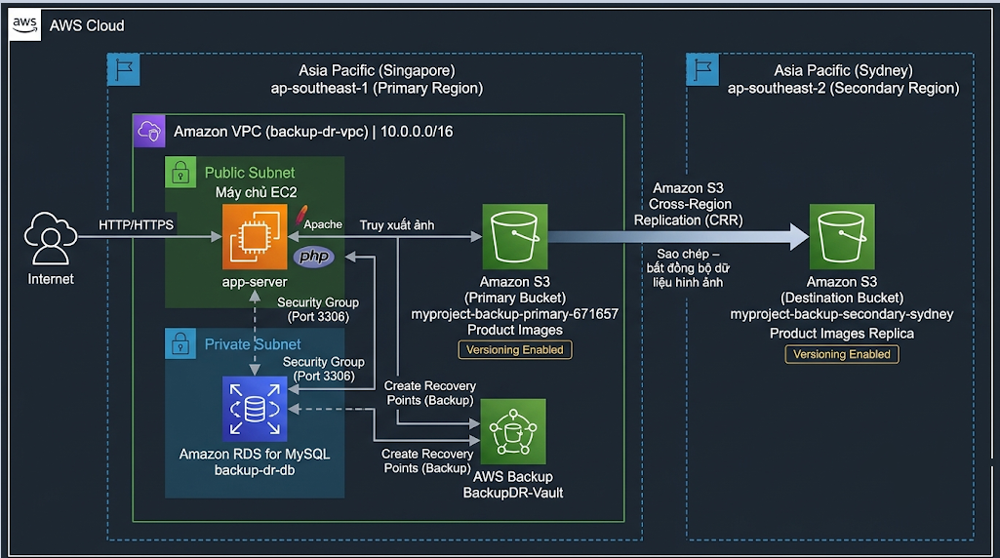

---
title: "AWS Architecture Design"
date: 2026-10-30
weight: 3
chapter: false
pre: " <b> 4.3. </b> "
---

### 1. Overview of the System Architecture

The system architecture is designed to deploy and protect the Maiora Fashion Store website using Amazon Web Services (AWS). The solution combines cloud infrastructure, database services, object storage, backup services, and cross-region data replication to improve data protection and system recoverability.

The primary environment is deployed in the Asia Pacific (Singapore) Region (`ap-southeast-1`). It hosts the website application, database, and primary storage resources.

The Asia Pacific (Sydney) Region (`ap-southeast-2`) is used as the destination for Amazon S3 Cross-Region Replication (CRR), providing an additional copy of product images in another AWS Region.

The architecture consists of the following main components:

- **Amazon VPC:** Provides an isolated network environment for application and database resources.
- **Amazon EC2:** Hosts the Maiora Fashion Store website using Apache and PHP.
- **Amazon RDS for MySQL:** Stores application data, including product information, customer accounts, shopping carts, and orders.
- **Amazon S3:** Stores product images and uses Versioning to maintain object versions.
- **Amazon S3 Cross-Region Replication:** Replicates objects from the primary S3 bucket in Singapore to a destination bucket in Sydney.
- **AWS Backup:** Manages backup and recovery points for supported resources, including EC2 and RDS.

### 2. Proposed System Architecture

The system is divided into two main geographical environments:

#### 2.1. Primary Region – Singapore

The Singapore Region is the primary operating environment of Maiora Fashion Store.

Its main components include:

- An Amazon VPC named `backup-dr-vpc` with the CIDR block `10.0.0.0/16`.
- An EC2 application server named `app-server`, deployed in a public subnet.
- An Amazon RDS MySQL database named `backup-dr-db`, configured for private access.
- An Amazon S3 bucket named `myproject-backup-primary-671657`, used to store product images.
- An AWS Backup vault named `BackupDR-Vault`, used to manage backup recovery points.

The EC2 instance runs the Apache web server and PHP application. It communicates with the RDS database through a private network connection.

The application retrieves product images from Amazon S3 instead of storing all image files directly on the EC2 instance.

#### 2.2. Secondary Region – Sydney

The Sydney Region provides an additional storage location for replicated product images.

Its main component is the destination Amazon S3 bucket, which receives replicated objects from the primary bucket in Singapore through Cross-Region Replication.

This arrangement provides another copy of product images in a separate AWS Region.

The Sydney Region is used as a secondary storage location in this workshop. It is not considered a fully deployed application recovery environment because separate EC2 and RDS application resources are not provisioned there.

### 3. Architecture Diagram

The following diagram illustrates the relationship between the primary application environment, backup services, and secondary storage environment.

The main data flows are:

1. Users access the Maiora Fashion Store website through the Internet.
2. The EC2 application server processes website requests and communicates with the RDS MySQL database.
3. Product images are retrieved from the primary S3 bucket.
4. Amazon S3 Cross-Region Replication copies eligible objects from Singapore to the destination bucket in Sydney.
5. AWS Backup creates recovery points for supported resources, including the EC2 application server and RDS database.
6. When a failure occurs, administrators can restore resources from available backup recovery points.

### 4. Data Protection and Backup Strategy

The solution applies different protection mechanisms according to the type of data and AWS resource.

#### 4.1. Application Server Backup

The EC2 application server hosts the website source code and application runtime environment.

AWS Backup is used to create recovery points for the EC2 instance. When the application server becomes unavailable or its configuration is damaged, administrators can restore the instance from an available recovery point.

After restoration, the application configuration and network associations must be checked before the website is accessed again.

#### 4.2. Database Backup

Amazon RDS for MySQL stores important application data, including:

- Product information.
- Customer account information.
- Shopping cart data.
- Order information.
- Order details.

AWS Backup is used to protect the RDS database by creating recovery points according to the configured backup process.

When data is lost or the database becomes unavailable, administrators can restore the database from a suitable recovery point.

Because a restored RDS database may have a different endpoint, the application database configuration must be updated when necessary.

#### 4.3. Product Image Protection

Amazon S3 stores the product images used by the website.

The following mechanisms are applied:

- S3 Versioning maintains multiple versions of objects.
- Cross-Region Replication copies eligible objects to a destination bucket in another AWS Region.
- Administrators can use available object versions to recover from accidental changes or deletions, subject to the configured versioning and replication behavior.

Cross-Region Replication operates asynchronously. Therefore, replication should not be assumed to be instantaneous, and replication status should be checked when validating recovery.

### 5. System Recovery Scenarios

The architecture supports several recovery scenarios.

| Failure Scenario | Recovery Approach |
|---|---|
| EC2 application server failure | Restore the EC2 instance from an AWS Backup recovery point. |
| RDS database failure or data loss | Restore the database from an available RDS recovery point. |
| Product image modification or deletion | Recover an appropriate object version from Amazon S3. |
| Primary S3 storage disruption | Use replicated objects in the Sydney destination bucket, subject to replication status and application configuration. |
| Website unavailable after restoration | Check application services, database endpoint, network settings, and public IP associations. |

The recovery process depends on the availability of backup recovery points, replicated objects, and the correct configuration of restored resources.

### 6. Security and Network Considerations

The architecture separates application and database resources to reduce unnecessary exposure.

The main security considerations include:

- The EC2 application server is deployed in a public subnet to provide website access.
- The RDS database is configured with public access disabled.
- The RDS Security Group allows MySQL traffic on TCP port `3306` only from the EC2 application server Security Group.
- SSH access to EC2 should be restricted to trusted administrator IP addresses.
- Amazon S3 Block Public Access and bucket policies should be configured according to the website's image delivery requirements.
- AWS Backup permissions should follow the principle of least privilege.

### 7. Expected Results

After completing the architecture design, the overall structure of the Maiora Fashion Store Backup and Disaster Recovery system is established.

The Singapore Region operates the website and database, while the Sydney Region stores replicated product images. AWS Backup provides recovery points for the EC2 application server and RDS database, and S3 Versioning provides additional protection for product images.

This architecture provides the foundation for the next workshop sections, where the AWS network, application, database, storage, backup, and recovery configurations will be implemented and tested.
