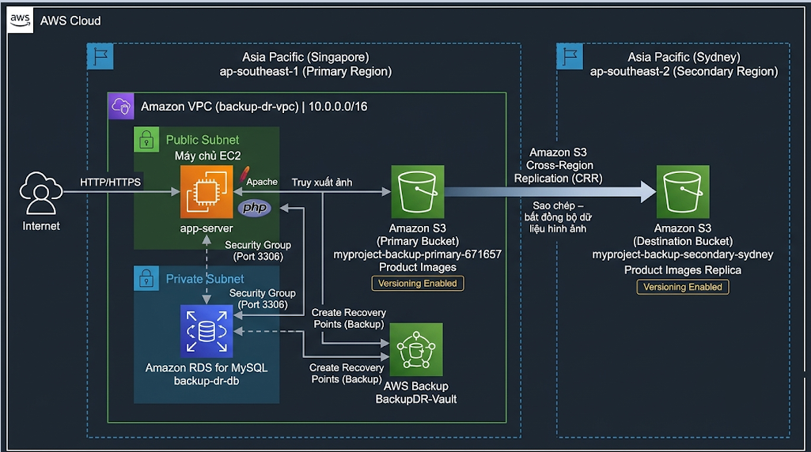

---
title: "Thiết kế kiến trúc hệ thống AWS"
date: 2026-10-30
weight: 3
chapter: false
pre: " <b> 4.3. </b> "
---

### 1. Tổng quan kiến trúc hệ thống

Kiến trúc hệ thống được thiết kế nhằm triển khai và bảo vệ website Maiora Fashion Store trên nền tảng Amazon Web Services (AWS). Giải pháp kết hợp hạ tầng điện toán đám mây, dịch vụ cơ sở dữ liệu, lưu trữ đối tượng, dịch vụ sao lưu và cơ chế sao chép dữ liệu giữa các Region nhằm tăng cường khả năng bảo vệ dữ liệu và phục hồi hệ thống.

Môi trường chính được triển khai tại khu vực Asia Pacific (Singapore) (`ap-southeast-1`). Đây là nơi vận hành website, cơ sở dữ liệu và các tài nguyên lưu trữ chính.

Khu vực Asia Pacific (Sydney) (`ap-southeast-2`) được sử dụng làm nơi nhận dữ liệu thông qua Amazon S3 Cross-Region Replication (CRR), tạo thêm một bản sao hình ảnh sản phẩm tại một AWS Region khác.

Kiến trúc bao gồm các thành phần chính sau:

- **Amazon VPC:** Cung cấp môi trường mạng riêng biệt cho các tài nguyên ứng dụng và cơ sở dữ liệu.
- **Amazon EC2:** Vận hành website Maiora Fashion Store sử dụng Apache và PHP.
- **Amazon RDS for MySQL:** Lưu trữ dữ liệu ứng dụng, bao gồm thông tin sản phẩm, tài khoản khách hàng, giỏ hàng và đơn hàng.
- **Amazon S3:** Lưu trữ hình ảnh sản phẩm và sử dụng Versioning để duy trì các phiên bản đối tượng.
- **Amazon S3 Cross-Region Replication:** Sao chép các đối tượng từ S3 bucket chính tại Singapore đến bucket đích tại Sydney.
- **AWS Backup:** Quản lý các bản sao lưu và recovery point cho những tài nguyên được hỗ trợ, bao gồm EC2 và RDS.

### 2. Kiến trúc hệ thống đề xuất

Hệ thống được chia thành hai môi trường địa lý chính:

#### 2.1. Primary Region – Singapore

Khu vực Singapore là môi trường vận hành chính của website Maiora Fashion Store.

Các thành phần chính bao gồm:

- Amazon VPC có tên `backup-dr-vpc` với CIDR `10.0.0.0/16`.
- Máy chủ ứng dụng EC2 có tên `app-server`, được triển khai trong public subnet.
- Cơ sở dữ liệu Amazon RDS MySQL có tên `backup-dr-db`, được cấu hình truy cập riêng tư.
- Amazon S3 bucket có tên `myproject-backup-primary-671657`, dùng để lưu trữ hình ảnh sản phẩm.
- AWS Backup vault có tên `BackupDR-Vault`, dùng để quản lý các recovery point.

EC2 vận hành máy chủ web Apache và ứng dụng PHP. Máy chủ ứng dụng giao tiếp với cơ sở dữ liệu RDS thông qua kết nối mạng riêng.

Ứng dụng lấy hình ảnh sản phẩm từ Amazon S3 thay vì lưu trữ toàn bộ tệp hình ảnh trực tiếp trên máy chủ EC2.

#### 2.2. Secondary Region – Sydney

Khu vực Sydney cung cấp một vị trí lưu trữ bổ sung cho các hình ảnh sản phẩm được sao chép.

Thành phần chính là S3 bucket đích, nhận các đối tượng được sao chép từ bucket chính tại Singapore thông qua Cross-Region Replication.

Cơ chế này tạo thêm một bản sao hình ảnh sản phẩm tại một AWS Region riêng biệt.

Trong workshop này, Sydney được sử dụng làm khu vực lưu trữ phụ. Đây chưa phải môi trường khôi phục ứng dụng hoàn chỉnh vì chưa triển khai riêng các tài nguyên EC2 và RDS phục vụ ứng dụng tại khu vực này.

### 3. Sơ đồ kiến trúc hệ thống

Sơ đồ dưới đây minh họa mối quan hệ giữa môi trường ứng dụng chính, dịch vụ sao lưu và môi trường lưu trữ phụ.

Các luồng dữ liệu chính:

1. Người dùng truy cập website Maiora Fashion Store thông qua Internet.
2. Máy chủ ứng dụng EC2 xử lý yêu cầu từ website và giao tiếp với cơ sở dữ liệu RDS MySQL.
3. Hình ảnh sản phẩm được truy xuất từ S3 bucket chính.
4. Amazon S3 Cross-Region Replication sao chép các đối tượng đủ điều kiện từ Singapore đến bucket đích tại Sydney.
5. AWS Backup tạo recovery point cho các tài nguyên được hỗ trợ, bao gồm máy chủ ứng dụng EC2 và cơ sở dữ liệu RDS.
6. Khi xảy ra sự cố, quản trị viên có thể khôi phục tài nguyên từ các recovery point khả dụng.

### 4. Chiến lược bảo vệ và sao lưu dữ liệu

Giải pháp áp dụng các cơ chế bảo vệ khác nhau tùy theo loại dữ liệu và tài nguyên AWS.

#### 4.1. Sao lưu máy chủ ứng dụng

Máy chủ ứng dụng EC2 lưu trữ mã nguồn website và môi trường thực thi ứng dụng.

AWS Backup được sử dụng để tạo recovery point cho EC2. Khi máy chủ ứng dụng không thể hoạt động hoặc cấu hình bị hỏng, quản trị viên có thể khôi phục instance từ recovery point phù hợp.

Sau khi khôi phục, cần kiểm tra cấu hình ứng dụng và các liên kết mạng trước khi truy cập lại website.

#### 4.2. Sao lưu cơ sở dữ liệu

Amazon RDS for MySQL lưu trữ các dữ liệu quan trọng của ứng dụng, bao gồm:

- Thông tin sản phẩm.
- Thông tin tài khoản khách hàng.
- Dữ liệu giỏ hàng.
- Thông tin đơn hàng.
- Chi tiết đơn hàng.

AWS Backup được sử dụng để bảo vệ cơ sở dữ liệu RDS thông qua việc tạo recovery point theo quy trình sao lưu đã cấu hình.

Khi dữ liệu bị mất hoặc cơ sở dữ liệu không thể hoạt động, quản trị viên có thể khôi phục database từ recovery point phù hợp.

Do cơ sở dữ liệu RDS sau khi khôi phục có thể có endpoint khác, cần cập nhật cấu hình kết nối database của ứng dụng khi cần thiết.

#### 4.3. Bảo vệ hình ảnh sản phẩm

Amazon S3 được sử dụng để lưu trữ hình ảnh sản phẩm trên website.

Các cơ chế bảo vệ được áp dụng:

- S3 Versioning duy trì nhiều phiên bản của đối tượng.
- Cross-Region Replication sao chép các đối tượng đủ điều kiện đến bucket đích tại một AWS Region khác.
- Quản trị viên có thể sử dụng các phiên bản đối tượng phù hợp để phục hồi khi xảy ra thay đổi hoặc xóa nhầm, tùy thuộc vào cấu hình Versioning và cơ chế sao chép.

Cross-Region Replication hoạt động theo cơ chế bất đồng bộ. Vì vậy, không nên mặc định dữ liệu được sao chép tức thời và cần kiểm tra trạng thái replication khi xác nhận khả năng phục hồi.

### 5. Các tình huống khôi phục hệ thống

Kiến trúc hỗ trợ một số tình huống khôi phục sau:

| Tình huống sự cố | Phương án khôi phục |
|---|---|
| Máy chủ ứng dụng EC2 gặp sự cố | Khôi phục EC2 từ recovery point của AWS Backup. |
| Cơ sở dữ liệu RDS gặp sự cố hoặc mất dữ liệu | Khôi phục database từ recovery point RDS khả dụng. |
| Hình ảnh sản phẩm bị thay đổi hoặc xóa | Khôi phục phiên bản đối tượng phù hợp từ Amazon S3. |
| S3 bucket chính gặp sự cố | Sử dụng các đối tượng đã được sao chép tại bucket đích Sydney, tùy thuộc trạng thái replication và cấu hình ứng dụng. |
| Website không hoạt động sau khi khôi phục | Kiểm tra dịch vụ ứng dụng, endpoint database, cấu hình mạng và liên kết địa chỉ IP công khai. |

Quá trình khôi phục phụ thuộc vào khả năng sẵn có của recovery point, dữ liệu đã được sao chép và cấu hình chính xác của các tài nguyên sau khi khôi phục.

### 6. Các yếu tố bảo mật và mạng

Kiến trúc tách biệt tài nguyên ứng dụng và cơ sở dữ liệu nhằm hạn chế việc để lộ các dịch vụ không cần thiết ra Internet.

Các nguyên tắc bảo mật chính:

- Máy chủ ứng dụng EC2 được triển khai trong public subnet để cung cấp khả năng truy cập website.
- Cơ sở dữ liệu RDS được cấu hình tắt Public access.
- RDS Security Group chỉ cho phép lưu lượng MySQL qua TCP port `3306` từ Security Group của máy chủ ứng dụng EC2.
- Quyền truy cập SSH vào EC2 nên được giới hạn theo địa chỉ IP tin cậy của quản trị viên.
- S3 Block Public Access và bucket policy cần được cấu hình phù hợp với yêu cầu phân phối hình ảnh của website.
- Quyền truy cập AWS Backup cần tuân theo nguyên tắc đặc quyền tối thiểu.

### 7. Kết quả mong đợi

Sau khi hoàn thành thiết kế kiến trúc, cấu trúc tổng thể của hệ thống Backup và Disaster Recovery cho Maiora Fashion Store được xác định.

Khu vực Singapore đảm nhiệm vận hành website và cơ sở dữ liệu, trong khi khu vực Sydney lưu trữ các hình ảnh sản phẩm được sao chép. AWS Backup cung cấp recovery point cho máy chủ ứng dụng EC2 và cơ sở dữ liệu RDS, còn S3 Versioning bổ sung cơ chế bảo vệ hình ảnh sản phẩm.

Kiến trúc này là nền tảng cho các phần tiếp theo của workshop, bao gồm triển khai mạng AWS, ứng dụng, cơ sở dữ liệu, lưu trữ, sao lưu và kiểm thử khôi phục hệ thống.
