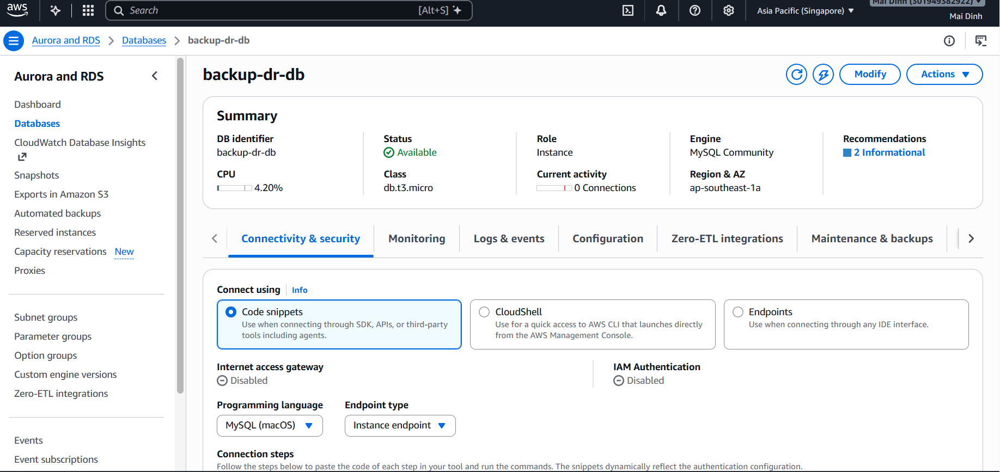
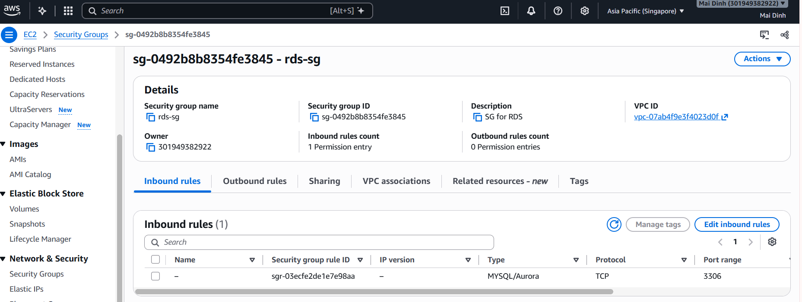
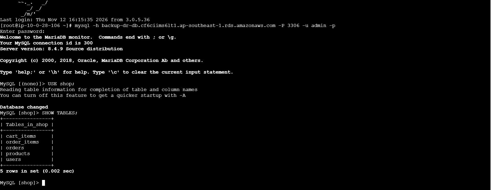
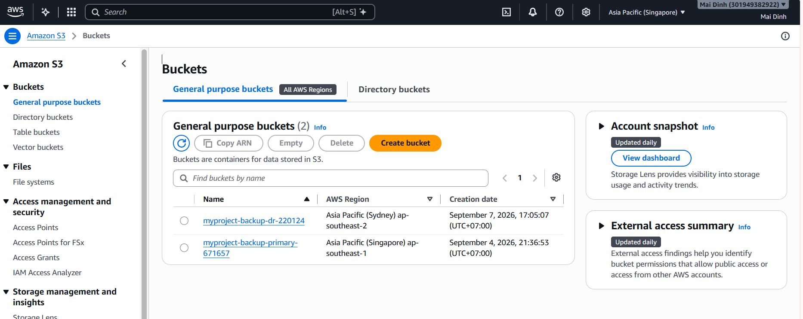
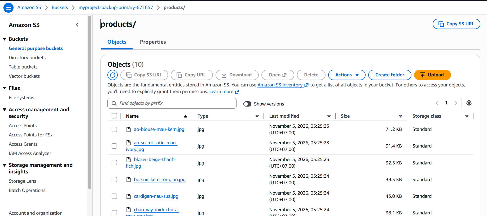

---
title: "Database and Storage Configuration"
date: 2026-11-10
weight: 5
chapter: false
pre: "<b> 4.5. </b>"
---

## 4.5. Database and Storage Configuration

In this section, Amazon RDS and Amazon S3 are configured to provide database and object storage services for the Maiora Fashion Store application.

The database stores application information such as user accounts, product details, shopping carts, and customer orders. Amazon S3 is used to store product images separately from the EC2 application server.

### 4.5.1. Creating an Amazon RDS MySQL Instance

Amazon RDS for MySQL is used as the relational database service for the application.

The database instance is configured with the following settings:

- Database engine: MySQL.
- DB instance identifier: `backup-dr-db`.
- Instance class: `db.t3.micro`.
- Storage: 20 GB.
- Database name: `shop`.
- Public access: No.
- VPC: `backup-dr-vpc`.
- VPC security group: `rds-sg`.

The RDS instance is deployed in the private network to prevent direct access from the public Internet.

### 4.5.2. Configuring Database Connectivity

The RDS security group is configured to allow MySQL connections on TCP port 3306 only from the EC2 application server security group.

This configuration ensures that the database is accessible to the application server without exposing the database directly to the Internet.

The application uses a separate configuration file to store database connection settings. Sensitive information such as database passwords is not stored in the public source code repository.

### 4.5.3. Creating the Application Database

After the database instance is available, the `shop` database is prepared for the Maiora Fashion Store application.

The database contains tables for managing the application's main functions:

- `users`: stores customer account information.
- `products`: stores product information.
- `cart_items`: stores shopping cart items.
- `orders`: stores customer order information.
- `order_items`: stores product details associated with each order.

These tables support the main shopping functions, including account registration, login, product display, shopping cart management, and order processing.

### 4.5.4. Creating an Amazon S3 Bucket

Amazon S3 is used to store product images separately from the EC2 application server.

A dedicated S3 bucket is created for the product images.

The bucket is configured with the following settings:

- Bucket name: `myproject-backup-primary-671657`.
- AWS Region: Asia Pacific (Singapore).
- Object ownership: Bucket owner enforced.
- Block Public Access: configured according to the application's image-access method.
- Server-side encryption: SSE-S3.

The application retrieves product images from S3 using their object locations.

### 4.5.5. Uploading Product Images to Amazon S3

Product images are uploaded to the `products/` prefix in the S3 bucket.

The application retrieves image locations from the database and displays the corresponding images on the website.

Separating product images from the application server makes storage management more flexible and supports the cross-region replication configuration in the next section.

### 4.5.6. Section Summary

In this section, Amazon RDS for MySQL and Amazon S3 are configured for the Maiora Fashion Store application.

Amazon RDS provides centralized relational database storage, while Amazon S3 stores product images independently of the EC2 application server.

These services form the database and storage foundation for the backup and disaster recovery implementation in the following sections.
