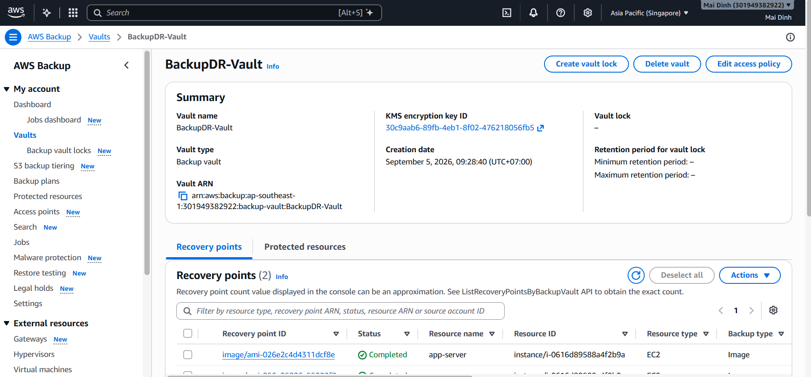
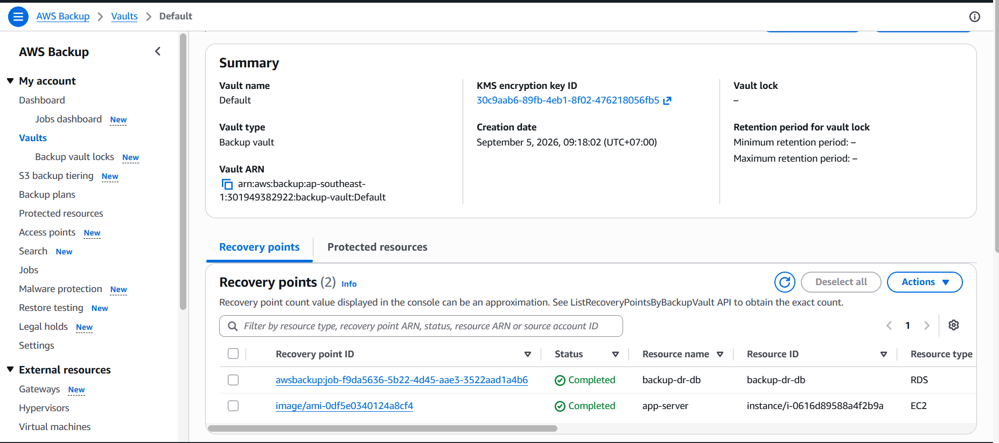
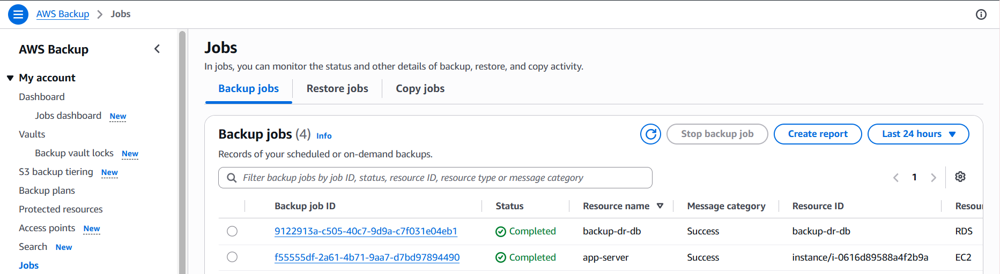
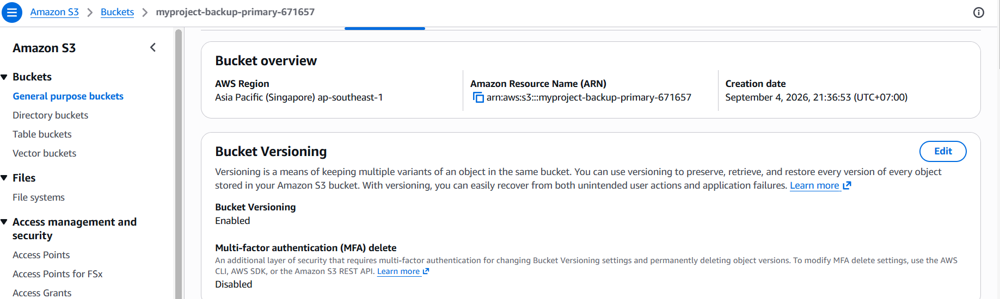
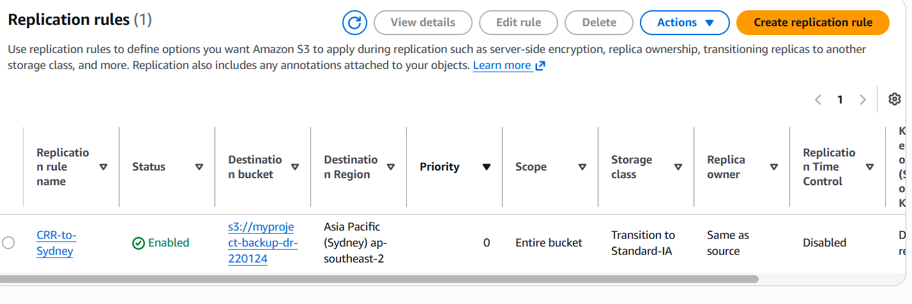
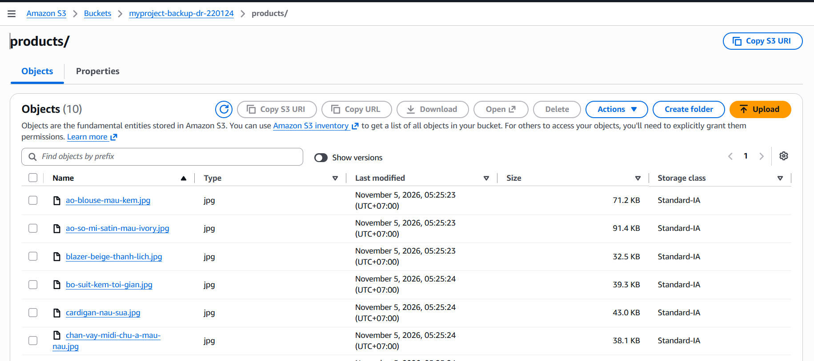

---
title: "Sao lưu và đồng bộ dữ liệu liên vùng"
date: 2026-10-31
weight: 6
chapter: false
pre: "<b>4.6.</b>"
---

## 4.6. Sao lưu và đồng bộ dữ liệu liên vùng

Trong phần này, AWS Backup và Amazon S3 Cross-Region Replication được cấu hình nhằm bảo vệ hạ tầng ứng dụng và hình ảnh sản phẩm của Maiora Fashion Store.

AWS Backup được sử dụng để tạo và quản lý các bản sao lưu của tài nguyên EC2 và RDS tại AWS Region chính (Singapore). Amazon S3 Cross-Region Replication (CRR) được sử dụng để sao chép hình ảnh sản phẩm từ S3 tại Singapore sang một Bucket đích tại Sydney.

### 4.6.1. Tạo AWS Backup Vault

AWS Backup Vault được sử dụng để tổ chức và quản lý các Recovery Point được tạo ra trong quá trình sao lưu.

Một Backup Vault có tên `BackupDR-Vault` được sử dụng tại Region Singapore để lưu trữ các Recovery Point của tài nguyên ứng dụng.

Vault cung cấp vị trí quản lý tập trung cho dữ liệu sao lưu và hỗ trợ quá trình khôi phục tài nguyên khi cần thiết.

### 4.6.2. Sao lưu tài nguyên EC2 và RDS

AWS Backup được sử dụng để tạo bản sao lưu cho máy chủ ứng dụng EC2 và cơ sở dữ liệu MySQL trên RDS.

Các tài nguyên được bảo vệ bao gồm:

- EC2: máy chủ ứng dụng đang vận hành website Maiora Fashion Store.
- RDS: cơ sở dữ liệu MySQL lưu trữ dữ liệu của ứng dụng.

Các tác vụ sao lưu theo yêu cầu (On-demand backup) được khởi chạy để tạo Recovery Point cho những tài nguyên đã lựa chọn.

Các Recovery Point này cung cấp dữ liệu sao lưu có thể sử dụng để khôi phục máy chủ ứng dụng hoặc cơ sở dữ liệu khi cần thiết.

### 4.6.3. Theo dõi trạng thái tác vụ sao lưu

AWS Backup cung cấp thông tin về các Backup Job để theo dõi tiến trình và trạng thái của hoạt động sao lưu.

Trạng thái của Backup Job được kiểm tra nhằm xác nhận tác vụ sao lưu đã hoàn thành thành công hay chưa.

Các thông tin quan trọng bao gồm:

- Loại tài nguyên và mã định danh tài nguyên.
- Trạng thái Backup Job.
- Thời gian bắt đầu và hoàn thành sao lưu.
- Thông tin Recovery Point được tạo.

Trạng thái hoàn thành thành công cho biết AWS Backup đã tạo Recovery Point tương ứng.

### 4.6.4. Bật tính năng S3 Versioning

Tính năng S3 Versioning được bật trên Bucket nguồn tại Singapore.

Versioning cho phép duy trì nhiều phiên bản của cùng một đối tượng trong một Bucket. Khi một đối tượng hiện có bị ghi đè hoặc xóa, các phiên bản trước đó có thể được giữ lại theo cơ chế quản lý phiên bản của S3.

Tính năng này giúp bảo vệ hình ảnh sản phẩm trước những thao tác ghi đè hoặc xóa nhầm, đồng thời cung cấp thêm khả năng khôi phục dữ liệu.

### 4.6.5. Cấu hình S3 Cross-Region Replication

Amazon S3 Cross-Region Replication (CRR) được cấu hình để sao chép hình ảnh sản phẩm từ Bucket nguồn tại Singapore sang Bucket đích tại Sydney.

Cấu hình sao chép bao gồm:

- Bucket nguồn: `myproject-backup-primary-671657`.
- Region nguồn: Asia Pacific (Singapore).
- Region đích: Asia Pacific (Sydney).
- Phạm vi sao chép: các đối tượng hình ảnh sản phẩm thuộc tiền tố `products/`.
- IAM Replication Role: vai trò IAM được cấp quyền sao chép đối tượng giữa hai Bucket.

Cả Bucket nguồn và Bucket đích đều phải bật S3 Versioning.

Sau khi quy tắc sao chép được kích hoạt, các đối tượng mới đủ điều kiện được tải lên Bucket nguồn sẽ tự động được sao chép sang Bucket đích. Quá trình sao chép diễn ra bất đồng bộ nên đối tượng tại Bucket đích có thể không xuất hiện ngay lập tức.

### 4.6.6. Kiểm tra dữ liệu được sao chép tại Sydney

Sau khi cấu hình quy tắc sao chép, Bucket đích tại Sydney được kiểm tra để xác nhận các hình ảnh sản phẩm đã được sao chép.

Bucket đích cung cấp một bản sao thứ cấp của các đối tượng hình ảnh sản phẩm đủ điều kiện tại một AWS Region khác.

Điều này góp phần cải thiện khả năng sẵn sàng của dữ liệu trong trường hợp Region hoặc Bucket nguồn gặp sự cố.

Cần lưu ý rằng S3 Cross-Region Replication không tự động sao chép toàn bộ các đối tượng cũ đã được tải lên trước khi quy tắc sao chép được kích hoạt. Những đối tượng hiện có có thể cần sử dụng S3 Batch Replication. Việc sao chép Delete Marker và thao tác xóa vĩnh viễn phiên bản cũng phụ thuộc vào cấu hình replication.

### 4.6.7. Tổng kết

Trong phần này, AWS Backup và Amazon S3 Cross-Region Replication được cấu hình để bảo vệ các thành phần dữ liệu khác nhau của hệ thống Maiora Fashion Store.

AWS Backup cung cấp các Recovery Point cho máy chủ ứng dụng EC2 và cơ sở dữ liệu RDS, trong khi S3 Cross-Region Replication tạo bản sao thứ cấp của các hình ảnh sản phẩm đủ điều kiện tại Sydney.

Sự kết hợp của hai cơ chế này giúp tăng cường khả năng bảo vệ và khôi phục hạ tầng ứng dụng cũng như dữ liệu hình ảnh được lưu trữ.
