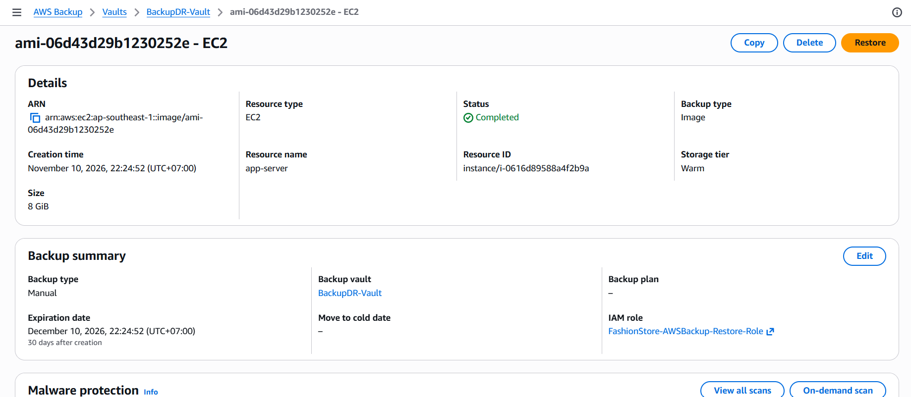
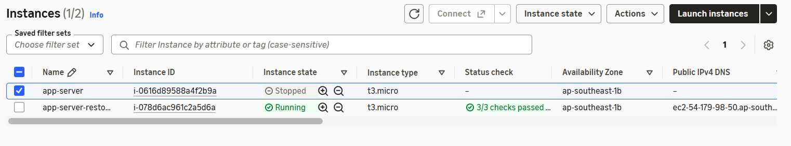
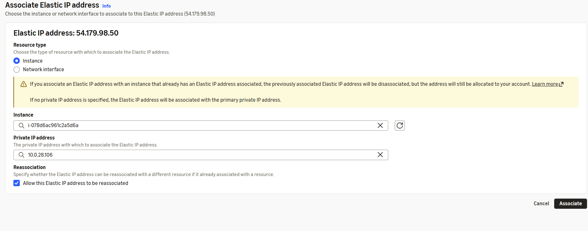
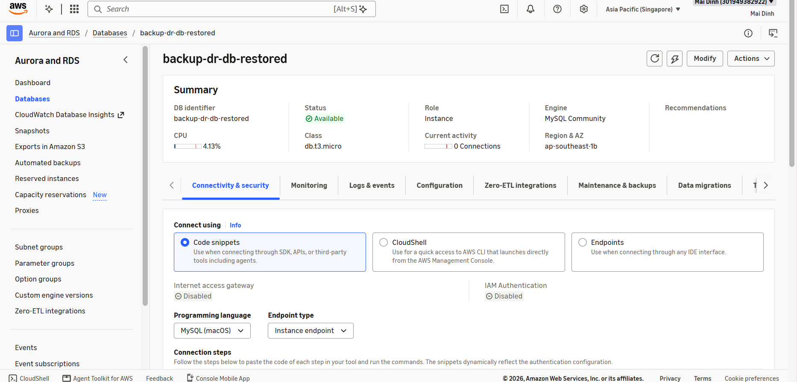
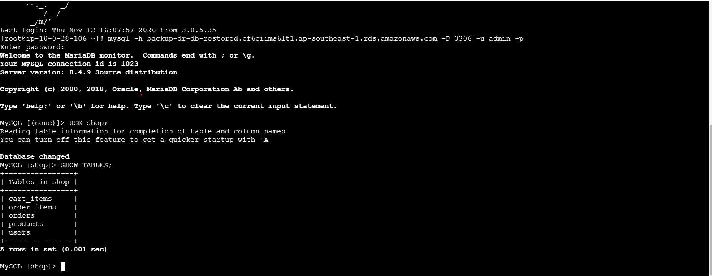
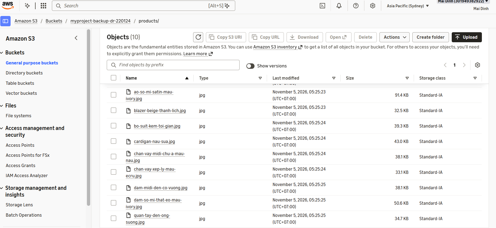
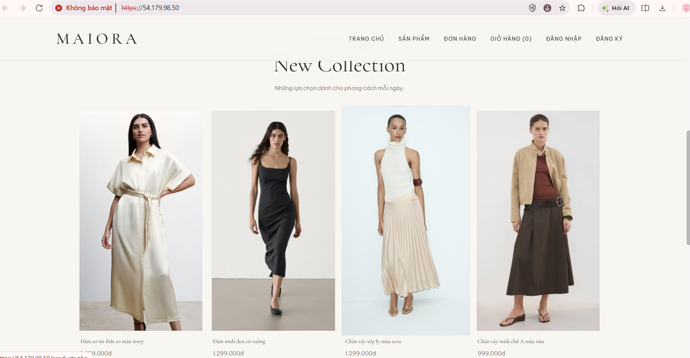

---
title: "Khôi phục sau thảm họa và phục hồi hệ thống"
date: 2026-11-1
weight: 7
chapter: false
pre: "<b>4.7.</b>"
---

## 4.7. Khôi phục sau thảm họa và phục hồi hệ thống

Phần này trình bày quy trình khôi phục hệ thống Maiora Fashion Store khi hạ tầng hoặc dữ liệu gặp sự cố và không thể sử dụng bình thường.

AWS Backup được sử dụng để khôi phục máy chủ ứng dụng EC2 và cơ sở dữ liệu MySQL trên RDS từ các Recovery Point hiện có. Amazon S3 cũng được kiểm tra nhằm xác nhận các hình ảnh sản phẩm đã sao chép vẫn có thể truy cập tại Region Sydney.

Quy trình khôi phục tập trung vào việc phục hồi các thành phần ứng dụng và kiểm tra khả năng hoạt động của website sau khi hoàn tất khôi phục.

### 4.7.1. Lựa chọn Recovery Point của EC2

Khi máy chủ ứng dụng EC2 gặp sự cố hoặc cần khôi phục dữ liệu, một Recovery Point phù hợp có thể được lựa chọn trong AWS Backup.

Recovery Point chứa dữ liệu sao lưu của EC2 tại thời điểm thực hiện sao lưu.

Recovery Point được lựa chọn dựa trên mã định danh tài nguyên, thời gian tạo và trạng thái sao lưu.

### 4.7.2. Khôi phục máy chủ ứng dụng EC2

Máy chủ EC2 được khôi phục thông qua AWS Backup bằng Recovery Point đã lựa chọn.

Trong quá trình khôi phục, các thông số cần thiết của phiên bản EC2 và cấu hình mạng được kiểm tra trước khi hoàn tất thao tác.

Sau khi Restore Job hoàn thành, AWS tạo một EC2 Instance được khôi phục. Instance mới được kiểm tra trong EC2 Console để xác nhận trạng thái hoạt động.

### 4.7.3. Gán lại Elastic IP Address

Nếu máy chủ ứng dụng ban đầu sử dụng Elastic IP, địa chỉ IP này có thể cần được gán lại cho EC2 Instance sau khi khôi phục.

Elastic IP được kiểm tra trong EC2 Console và thực hiện liên kết với Instance đã khôi phục khi cần thiết.

Bước này cho phép người dùng tiếp tục truy cập website thông qua cùng một địa chỉ IP công khai, với điều kiện địa chỉ IP vẫn khả dụng và thuộc cùng AWS Region.

### 4.7.4. Khôi phục cơ sở dữ liệu MySQL trên RDS

Cơ sở dữ liệu RDS được khôi phục từ Recovery Point có sẵn trong AWS Backup hoặc từ một Database Snapshot đã được tạo trước đó.

Trong quá trình khôi phục, các thông số cấu hình cơ sở dữ liệu được kiểm tra, bao gồm DB Instance Identifier, VPC, Subnet Group, Security Group và thiết lập khả năng truy cập cơ sở dữ liệu.

Amazon RDS tạo một DB Instance mới cho cơ sở dữ liệu được khôi phục. Cấu hình kết nối của ứng dụng cần được cập nhật nếu cơ sở dữ liệu sau khôi phục có Endpoint khác với ban đầu.

### 4.7.5. Kiểm tra cơ sở dữ liệu sau khôi phục

Sau khi RDS Instance được khôi phục chuyển sang trạng thái sẵn sàng, trạng thái và thông tin kết nối của cơ sở dữ liệu được kiểm tra.

Cơ sở dữ liệu ứng dụng được kiểm tra nhằm xác nhận các dữ liệu cần thiết vẫn còn tồn tại.

Cơ sở dữ liệu bao gồm các bảng chính:

- `users`
- `products`
- `cart_items`
- `orders`
- `order_items`

Việc kiểm tra này giúp xác nhận quá trình khôi phục cơ sở dữ liệu đã phục hồi được các dữ liệu cần thiết cho ứng dụng.

### 4.7.6. Kiểm tra hình ảnh sản phẩm tại Region Sydney

Bucket S3 đích tại Sydney được kiểm tra nhằm xác nhận các hình ảnh sản phẩm đã sao chép vẫn có thể truy cập.

Các đối tượng trong tiền tố `products/` được kiểm tra để xác nhận những hình ảnh cần thiết đã xuất hiện tại Bucket đích.

Các đối tượng được sao chép cung cấp thêm một bản lưu trữ của hình ảnh sản phẩm đủ điều kiện tại một AWS Region khác.

### 4.7.7. Kiểm tra website Maiora Fashion Store sau khôi phục

Sau khi máy chủ ứng dụng EC2 và cơ sở dữ liệu RDS được khôi phục, đồng thời các thông số kết nối được cập nhật, website Maiora Fashion Store được truy cập để kiểm tra.

Các chức năng chính của ứng dụng được kiểm tra bao gồm:

- Trang chủ website có thể tải thành công.
- Thông tin sản phẩm được hiển thị.
- Hình ảnh sản phẩm có thể được truy xuất từ Amazon S3.
- Các trang đăng nhập và đăng ký tài khoản có thể truy cập.
- Các chức năng giỏ hàng và đơn hàng có thể sử dụng.

Quá trình kiểm tra giúp xác nhận các thành phần ứng dụng sau khi khôi phục có thể phối hợp hoạt động và cung cấp những chức năng chính của website.

### 4.7.8. Tổng kết

Trong phần này, quy trình khôi phục máy chủ ứng dụng EC2 và cơ sở dữ liệu RDS được thực hiện thông qua các Recovery Point có sẵn.

Elastic IP được gán lại khi cần thiết, đồng thời các hình ảnh sản phẩm đã sao chép tại Region Sydney được kiểm tra.

Kết quả kiểm tra website giúp xác nhận liệu hạ tầng ứng dụng, cơ sở dữ liệu và hệ thống lưu trữ hình ảnh sau khôi phục có thể đáp ứng các chức năng chính của Maiora Fashion Store hay không.
