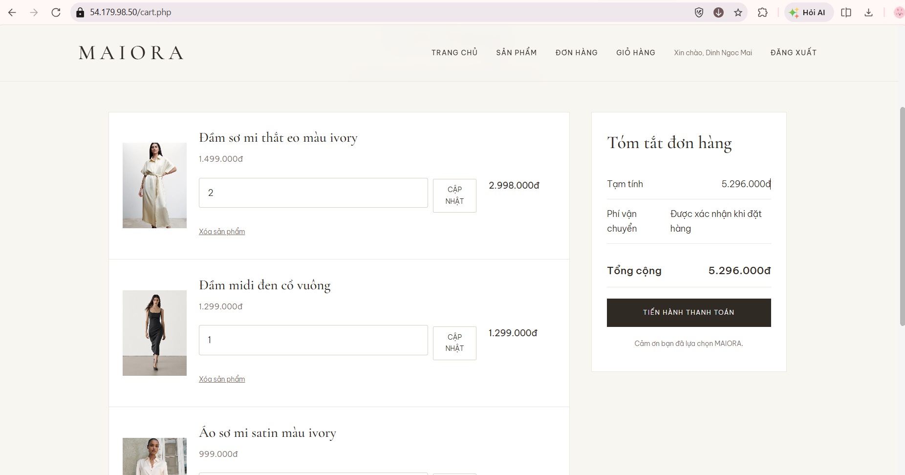
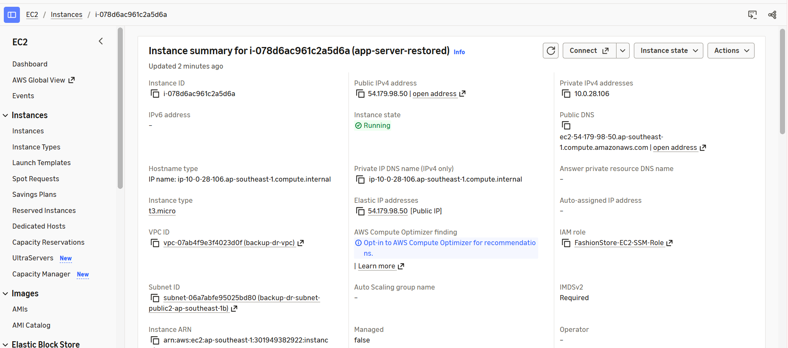
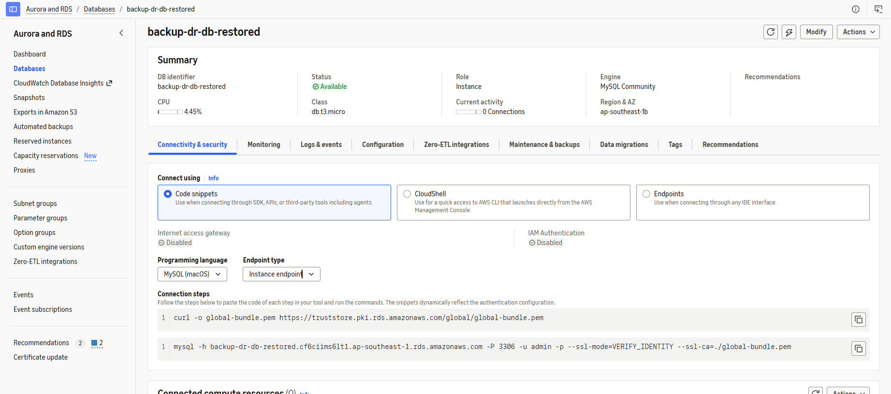
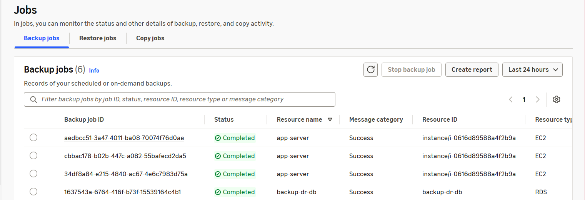

---
title: "Testing, Monitoring and Cleanup"
date: 2026-11-10
weight: 8
chapter: false
pre: "<b> 4.8. </b>"
---

## 4.8. Testing, Monitoring and Cleanup

This section presents the final testing, monitoring, and resource cleanup activities for the Maiora Fashion Store system deployed on AWS.

The purpose is to verify that the application and its supporting AWS services operate as expected, review the status of backup resources, and remove unnecessary resources to minimize additional costs.

### 4.8.1. Testing the Website Homepage

The Maiora Fashion Store homepage is accessed through a web browser to verify that the application is available.

The following items are checked:

- The website can be accessed successfully.
- The homepage layout is displayed correctly.
- Product information is loaded.
- Product images are displayed correctly.

This test provides an initial confirmation that the EC2 application server, database, and image storage can support the website.

### 4.8.2. Testing Main Application Functions

The main functions of the Maiora Fashion Store application are tested through the website interface.

The test cases include:

- User registration and login.
- Product listing and product detail display.
- Adding products to the shopping cart.
- Viewing shopping cart information.
- Placing an order.
- Viewing order information.

The test results are reviewed to confirm that the main application functions are available after deployment and recovery.

### 4.8.3. Checking EC2 Instance Status

The EC2 application server is reviewed in the AWS Management Console.

The following information is checked:

- Instance state.
- Instance type.
- Public IPv4 address or Elastic IP address, if configured.
- VPC and subnet association.

The application server should be in the Running state when the website is being tested.

### 4.8.4. Checking RDS Database Status

The RDS database is reviewed to verify its availability and configuration.

The following information is checked:

- DB instance status.
- Database engine.
- DB instance identifier.
- VPC and security group configuration.
- Public accessibility setting.

The database should be available and configured for private access from the EC2 application server.

### 4.8.5. Reviewing AWS Backup Status

AWS Backup is reviewed to confirm that the expected recovery points are available.

The Backup Vault and backup job information are checked to review the backup status and identify available recovery points for the protected resources.

This activity helps verify that backup data is available for future restoration operations.

### 4.8.6. Cleaning Up Unnecessary AWS Resources

After completing the deployment and testing activities, unnecessary resources are reviewed to reduce AWS costs.

The cleanup process includes:

- Stopping EC2 instances that are no longer required.
- Deleting temporary EC2 instances created during restoration tests, if they are no longer needed.
- Reviewing unused EBS volumes and snapshots before deleting them.
- Reviewing RDS instances and deleting temporary restored instances only after confirming that they are no longer needed.
- Reviewing unused Elastic IP addresses and releasing them when appropriate.
- Keeping required backup recovery points and S3 data according to the project's retention requirements.

Before deleting any resource, its role in the application and backup process must be checked to avoid accidental data loss or service interruption.

### 4.8.7. Final Evaluation

The final evaluation reviews the main results of the AWS Backup and Disaster Recovery implementation.

The system provides the following capabilities:

- Hosting the Maiora Fashion Store website on Amazon EC2.
- Storing application data in Amazon RDS for MySQL.
- Storing product images in Amazon S3.
- Creating EC2 and RDS recovery points through AWS Backup.
- Maintaining eligible replicated product images in the Sydney Region through S3 Cross-Region Replication.
- Restoring application resources from available backup data and checking the website after recovery.

The implementation demonstrates how AWS services can be combined to protect application infrastructure and data while maintaining a cost-conscious deployment approach.

### 4.8.8. Workshop Conclusion

Through this workshop, the Maiora Fashion Store application is deployed on AWS with database storage, object storage, backup, and cross-region image replication.

The testing and restoration activities demonstrate the use of AWS services to support data protection and application recovery.

The workshop provides practical experience in deploying, protecting, testing, and managing a small web application infrastructure on Amazon Web Services.
