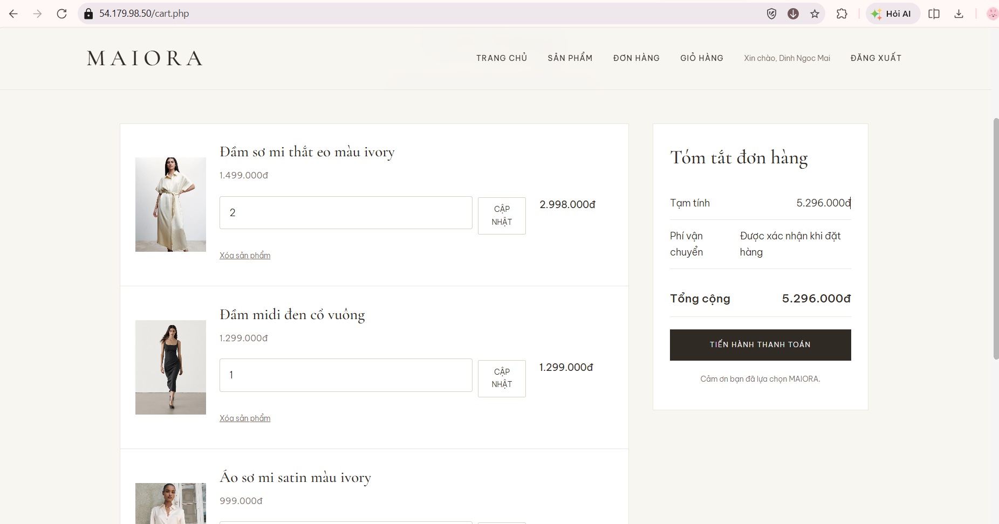
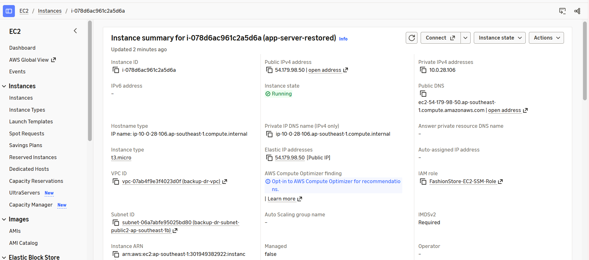
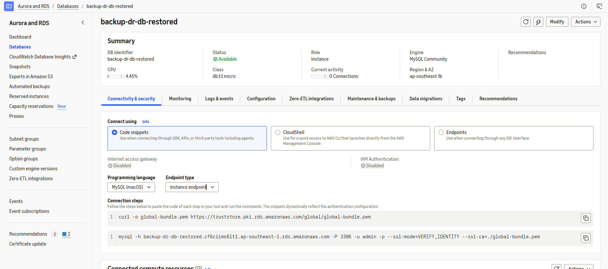
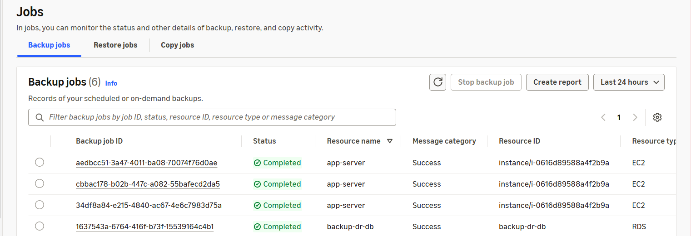

---
title: "Kiểm thử, giám sát và dọn dẹp tài nguyên"
date: 2026-11-10
weight: 8
chapter: false
pre: "<b> 4.8. </b>"
---

## 4.8. Kiểm thử, giám sát và dọn dẹp tài nguyên

Phần này trình bày các hoạt động kiểm thử, giám sát và dọn dẹp tài nguyên sau khi triển khai hệ thống Maiora Fashion Store trên AWS.

Mục tiêu là xác nhận ứng dụng và các dịch vụ AWS hỗ trợ hoạt động theo yêu cầu, kiểm tra trạng thái các tài nguyên sao lưu và loại bỏ những tài nguyên không cần thiết nhằm hạn chế chi phí phát sinh.

### 4.8.1. Kiểm thử trang chủ website

Website Maiora Fashion Store được truy cập thông qua trình duyệt để xác nhận ứng dụng có thể hoạt động.

Các nội dung được kiểm tra bao gồm:

- Website có thể truy cập thành công.
- Giao diện trang chủ được hiển thị chính xác.
- Thông tin sản phẩm được tải lên.
- Hình ảnh sản phẩm được hiển thị bình thường.

Bước kiểm thử này giúp xác nhận ban đầu rằng máy chủ ứng dụng EC2, cơ sở dữ liệu và hệ thống lưu trữ hình ảnh có thể phối hợp phục vụ website.

### 4.8.2. Kiểm thử các chức năng chính của ứng dụng

Các chức năng chính của Maiora Fashion Store được kiểm thử thông qua giao diện website.

Các trường hợp kiểm thử bao gồm:

- Đăng ký và đăng nhập tài khoản.
- Hiển thị danh sách và thông tin chi tiết sản phẩm.
- Thêm sản phẩm vào giỏ hàng.
- Xem thông tin giỏ hàng.
- Thực hiện đặt hàng.
- Xem thông tin đơn hàng.

Kết quả kiểm thử được xem xét nhằm xác nhận các chức năng chính của ứng dụng có thể hoạt động sau khi triển khai và khôi phục hệ thống.

### 4.8.3. Kiểm tra trạng thái EC2 Instance

Máy chủ ứng dụng EC2 được kiểm tra thông qua AWS Management Console.

Các thông tin được kiểm tra bao gồm:

- Trạng thái Instance.
- Loại Instance.
- Địa chỉ Public IPv4 hoặc Elastic IP nếu đã cấu hình.
- VPC và Subnet được liên kết.

Máy chủ ứng dụng cần ở trạng thái Running trong quá trình kiểm thử website.

### 4.8.4. Kiểm tra trạng thái cơ sở dữ liệu RDS

Cơ sở dữ liệu RDS được kiểm tra nhằm xác nhận trạng thái hoạt động và cấu hình.

Các thông tin được kiểm tra bao gồm:

- Trạng thái DB Instance.
- Hệ quản trị cơ sở dữ liệu.
- DB Instance Identifier.
- Cấu hình VPC và Security Group.
- Thiết lập Public Accessibility.

Cơ sở dữ liệu cần ở trạng thái sẵn sàng và được cấu hình để chỉ cho phép máy chủ ứng dụng EC2 truy cập theo quy tắc bảo mật đã thiết lập.

### 4.8.5. Kiểm tra trạng thái AWS Backup

AWS Backup được kiểm tra nhằm xác nhận các Recovery Point cần thiết vẫn tồn tại và có thể sử dụng.

Backup Vault và thông tin Backup Job được xem xét để kiểm tra trạng thái sao lưu cũng như xác định các Recovery Point hiện có của những tài nguyên được bảo vệ.

Hoạt động này giúp xác nhận dữ liệu sao lưu đã được tạo và có thể sử dụng cho những lần khôi phục tiếp theo.

### 4.8.6. Dọn dẹp các tài nguyên AWS không cần thiết

Sau khi hoàn thành triển khai và kiểm thử, các tài nguyên không còn cần thiết được rà soát nhằm giảm chi phí sử dụng AWS.

Quá trình dọn dẹp bao gồm:

- Dừng các EC2 Instance không còn cần thiết.
- Xóa các EC2 Instance tạm thời được tạo trong quá trình thử nghiệm khôi phục nếu không còn sử dụng.
- Kiểm tra các EBS Volume và Snapshot không còn sử dụng trước khi xóa.
- Kiểm tra các RDS Instance và chỉ xóa những Instance được khôi phục tạm thời sau khi xác nhận không còn cần thiết.
- Kiểm tra các Elastic IP không còn sử dụng và giải phóng khi phù hợp.
- Giữ lại các Recovery Point và dữ liệu S3 cần thiết theo yêu cầu lưu trữ của đề tài.

Trước khi xóa bất kỳ tài nguyên nào, cần kiểm tra vai trò của tài nguyên đó trong hệ thống ứng dụng và quy trình sao lưu để tránh mất dữ liệu hoặc làm gián đoạn dịch vụ ngoài ý muốn.

### 4.8.7. Đánh giá kết quả triển khai

Phần đánh giá cuối cùng tổng hợp những kết quả chính của quá trình triển khai giải pháp AWS Backup và Disaster Recovery.

Hệ thống cung cấp các khả năng sau:

- Triển khai website Maiora Fashion Store trên Amazon EC2.
- Lưu trữ dữ liệu ứng dụng trên Amazon RDS for MySQL.
- Lưu trữ hình ảnh sản phẩm trên Amazon S3.
- Tạo Recovery Point cho EC2 và RDS thông qua AWS Backup.
- Duy trì bản sao của các hình ảnh sản phẩm đủ điều kiện tại Region Sydney thông qua S3 Cross-Region Replication.
- Khôi phục tài nguyên ứng dụng từ dữ liệu sao lưu hiện có và kiểm tra website sau khi khôi phục.

Kết quả triển khai cho thấy có thể kết hợp các dịch vụ AWS để bảo vệ hạ tầng ứng dụng và dữ liệu, đồng thời duy trì phương án triển khai có cân nhắc đến chi phí.

### 4.8.8. Kết luận Workshop

Thông qua Workshop, ứng dụng Maiora Fashion Store được triển khai trên AWS với các thành phần cơ sở dữ liệu, lưu trữ đối tượng, sao lưu và đồng bộ hình ảnh liên vùng.

Các hoạt động kiểm thử và khôi phục minh họa cách sử dụng dịch vụ AWS nhằm hỗ trợ bảo vệ dữ liệu và phục hồi ứng dụng.

Workshop cung cấp kinh nghiệm thực tế trong việc triển khai, bảo vệ, kiểm thử và quản lý hạ tầng ứng dụng web trên Amazon Web Services.
